<!-- Visuals are generated locally and by .github/workflows/profile.yml. -->

  

  
  
  

  <strong>Frontend developer · Sochi, Russia</strong> 
  Building interfaces with React &amp; TypeScript. 
  Making everyday life a little easier with Python tools and Telegram bots.

<h3 align="center">⌘ &nbsp; Toolbox</h3>

  

REACT · TYPESCRIPT · NEXT.JS &nbsp; / &nbsp; PYTHON · AUTOMATION &nbsp; / &nbsp; APIs · TELEGRAM

<h3 align="center">↗ &nbsp; Things I've built</h3>

  
  
   
  
  

<h3 align="center">◈ &nbsp; GitHub telemetry</h3>

  
  

  

<h3 align="center">⌁ &nbsp; Feed the snake</h3>

My contribution graph, with a life of its own.

  <picture>
    <source media="(prefers-color-scheme: dark)" srcset="./assets/generated/snake-dark.svg" />
    <source media="(prefers-color-scheme: light)" srcset="./assets/generated/snake.svg" />
    
  </picture>

  

  
Behind this profile

   
  Animated SVGs, real public GitHub data, and a daily GitHub Actions workflow.
  <ul>
    <li>Custom terminal, project cards and contribution skyline: <a href="./scripts/render_profile.py">Python SVG renderer</a>.</li>
    <li>Stats: <a href="https://github.com/stats-organization/github-readme-stats-action">GitHub Readme Stats Action</a>. Language shares describe repository contents, not skill levels.</li>
    <li>Contribution animation: <a href="https://github.com/Platane/snk">Platane/snk</a>.</li>
    <li>Technology icons: <a href="https://github.com/tandpfun/skill-icons">Skill Icons</a>. Contact badges: <a href="https://shields.io">Shields.io</a>.</li>
    <li>Calendar project builds on <a href="https://github.com/noXplode/aiogram_calendar">aiogram_calendar</a>.</li>
  </ul>
  <a href="https://github.com/KobetsDev/KobetsDev/actions/workflows/profile.yml">Widget refresh status ↗</a>

